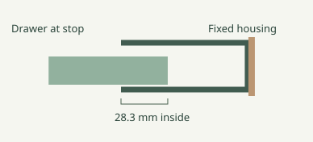

# Cardboard core drawer wall · R3.10

[Interactive assembly](datasheet.html) · [Left side kit](models/left-pocket-r3-10.3mf) · [Right side kit](models/right-pocket-r3-10.3mf) · [First cell](../r3-8/models/starter-r3-8.3mf)

## Install a side pocket

1. Seat the rear rim clips of the housing on the three neighboring cardboard cores while assembling that edge of the bank. Rest the bank on its shelf against the ¾″ plywood. Install the front face frame over the mouth and onto the front cardboard rims. Its tall outside edge surrounds and bears against the sleeve.
2. With the drawer out, drive a #8 × ¾″ pan-head wood screw through the recessed hole inside the back into the plywood. Keep the head below the drawer path. The housing encloses the top, floor, sides and back. The four-screw example also has a middle and top anchor. No adhesive or bolts.
3. Insert the drawer and press the short split keeper into the outside of the housing until its head seats. It runs in a closed-bottom groove on the drawer. To remove the bin, pull the keeper by its head. Keep the outside accessible. Print the keeper head down, the bin open side up, the face frame flat and the housing back down, as supplied.
4. Test one pocket on your cardboard before loading a bank. The nominal slide clearance is 0.44 mm per side. The drawer opens 41.1 mm and keeps 28.3 mm in its guide at the stop. The opening is overlapped by the front when closed; it is not airtight.

| Complete side kit | Capacity | PLA | P1S slice time |
| --- | ---: | ---: | ---: |
| [left-pocket](models/left-pocket-r3-10.3mf) | 120.0 mL | 68.07 g | 106 min |
| [right-pocket](models/right-pocket-r3-10.3mf) | 121.6 mL | 68.13 g | 107 min |

Each kit has a drawer, enclosed housing with rear rim seats, front frame and keeper. The [three pencil cubbies](../r3-9/cubbies.svg) still pass through the full core depth. For the remaining parts and quantities see the [bank assembly notes](../r3-9/README.md); replace the two old edge kits with these housings and add two backboard screws.

[CAD fit and stop checks](checks.json) · [Bambu slice results](slice-checks.json). All pocket plates sliced on a P1S with PLA, 0.4 mm nozzle, 0.20 mm layers, three walls, 15% gyroid, supports off and brim off. Travel, keeper fit, loaded strength and wear have not yet been tested on a physical print.
